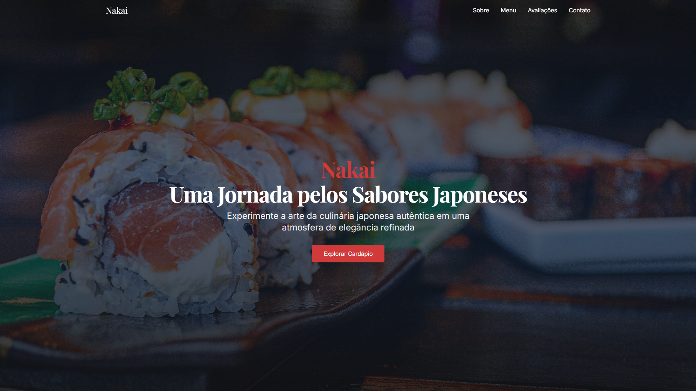
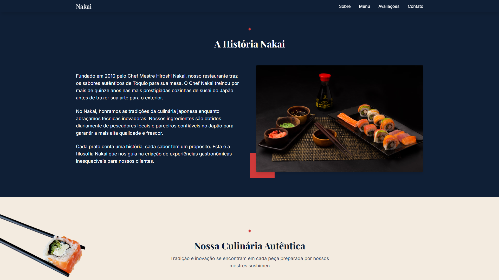
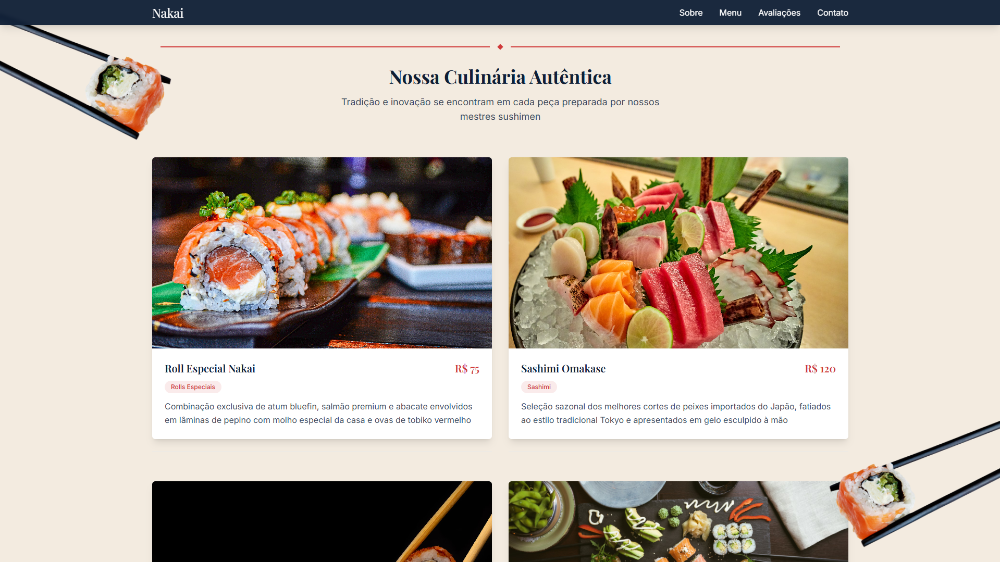
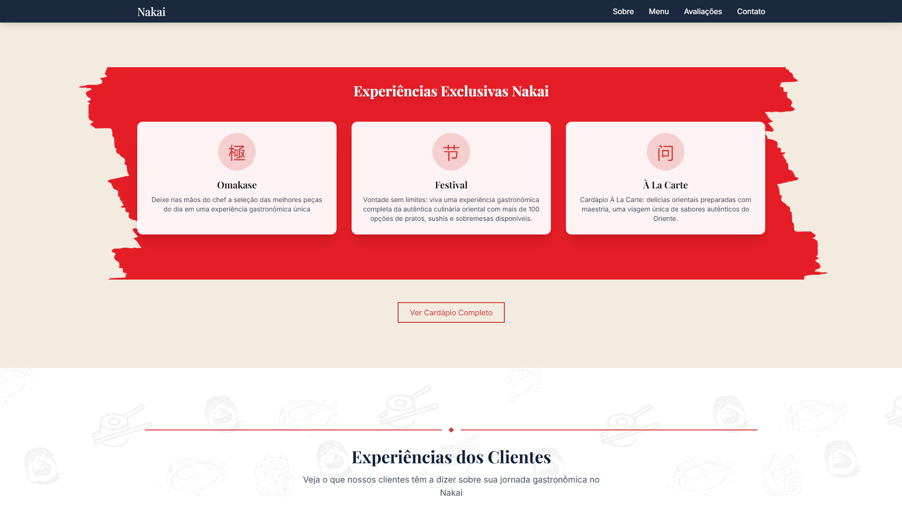
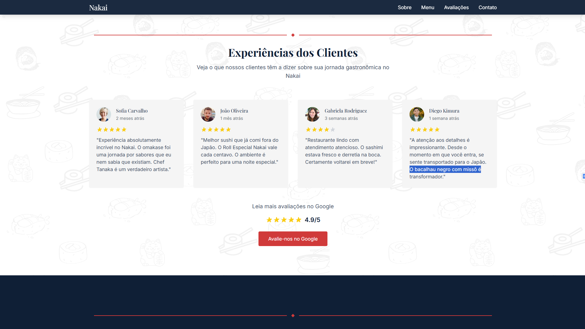
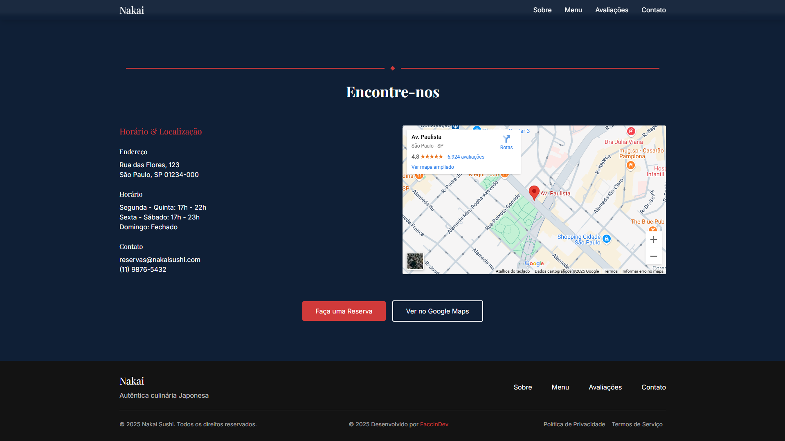

# 🍣 Nakai - Restaurante Japonês

Landing page moderna e responsiva desenvolvida para o restaurante japonês **Nakai**, com animações suaves e interações elegantes utilizando **GSAP + ScrollTrigger**. O projeto foi construído com **Next.js**, visando performance, SEO e experiência do usuário.

## 📸 Screenshots

| Home | Sobre | Menu |
|------|-------|------|
|  |  |  |

| Exclusividades | Avaliações | Localização |
|----------|---------|--------|
|  |  |  |


## 🚀 Tecnologias Utilizadas

- **[Next.js](https://nextjs.org/)** – Framework React para SSR, performance e SEO.
- **[GSAP](https://greensock.com/gsap/)** – Biblioteca para animações suaves.
- **[GSAP ScrollTrigger](https://greensock.com/scrolltrigger/)** – Plugin para animações baseadas no scroll.
- **[Tailwind](https://github.com/faccin27)** – Framework CSS pora estilização da pagina.


## 📂 Estrutura do Projeto

```bash
.
├── public/
│   └── images/            # Assets estáticos
├── src/
│   ├── app/               # Páginas da aplicação
│   ├── components/        # Componentes utilizados e reutilizaveis
│   ├── data/              # Itens dinamicos e mockdatas
│   └── lib/               # Configurações do GSAP
└── README.md
````


## 🧪 Como Rodar o Projeto

```bash
# Clone o repositório
git clone https://github.com/Faccin27/nakai-sushi-gsap
cd nakai-sushi-gsap

# Instale as dependências
npm install

# Rode em ambiente de desenvolvimento
npm run dev
```


## 📦 Build para Produção

```bash
npm run build
npm start
```


## 📱 Responsividade

O site foi pensado para uma experiência perfeita tanto no **desktop quanto no mobile**, com transições suaves e carregamento rápido.


## 💡 Diferenciais

* Animações fluidas com GSAP ScrollTrigger
* Navegação elegante com scroll animado
* Layout refinado com tipografia e cores inspiradas na cultura japonesa
* Componentização organizada para fácil manutenção

## 📬 Contato

Caso queira usar este projeto como base ou tenha sugestões:

**Email**: [gfaccin27@gmail.com](mailto:gfaccin27@gmail.com)
**LinkedIn**: [Guilherme Faccin](https://linkedin.com/in/guilherme-faccin)

## 🧾 Licença

Este projeto é de uso livre para fins educacionais e não comerciais.

